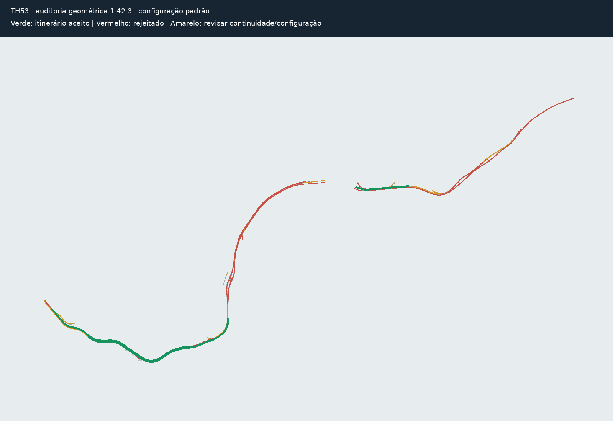

# TH53 — validação com o DXF fornecido

Arquivo: DUPLICAÇÃO TH53.dxf, 21.106.984 bytes; unidades declaradas: metros.
SHA-256: `7936e09e195212a85a894dbc48f5ad337f0cbe4f3195225e6f8137297e3e4538`.
O arquivo original é conservado fora do checkout e não integra o pacote.

Foi usado Scene.light, com Settings padrão, imagem neutra, hidrografia desligada,
1280 px, 24 fps e duração de simulação de 30 segundos. As mesmas configurações
foram aplicadas aos fontes empacotados da 1.42.2 e aos fontes atuais da 1.42.3.
A análise cinemática da 1.42.3 foi aplicada às trajetórias de ambas as versões.

| Resultado | 1.42.2 | 1.42.3 |
|---|---:|---:|
| Itinerários produzidos | 14 | 4 |
| Aprovados pela análise cinemática | 7 | 4 |
| Com problemas geométricos | 7 | 0 |

Na 1.42.2, seis itinerários apresentaram corpo fora da pista e um apresentou
simultaneamente auto-interseção, mudança brusca e esterçamento excessivo.
A nova rede aplica também restrições de continuidade e de ligação, portanto a
diferença de 14 para 4 não corresponde apenas aos sete itinerários inválidos.
Na 1.42.3, 99 segmentos curtos foram ignorados. Foram simulados 25 veículos,
sem colisões traseiras detectadas. Frente/traseira e limites por classe foram
analisados; o detalhamento das quatro trajetórias está em resultado.json.

A imagem é uma vista técnica independente, sem imagem aérea. Verde representa
os itinerários aceitos; vermelho, arestas recusadas; amarelo, trechos que exigem
revisão de continuidade/configuração. Não é um quadro do vídeo exportado.

## Pendências para validar todo o entroncamento

O projeto salvo com o mapeamento de camadas, rotas editadas, sentidos e
proibições não acompanhou o DXF. A busca nas sete branches disponíveis do
repositório e nos ZIPs versionados não encontrou DXF/KMZ/projeto salvo.
Há geometria na camada 0 e avisos de acostamentos sem áreas fechadas, que
precisam ser conferidos no projeto. Não é correto habilitar automaticamente os
ramais restantes apenas para aumentar a circulação.

O CRS padrão legado EPSG:31983 não foi confirmado, e nenhum KMZ foi fornecido.
A análise foi planar nas unidades declaradas do DXF, sem georreferenciamento
validado. Não constitui certificação CONTRAN nem análise completa de conflitos
em cruzamentos. Quatro itinerários aceitos não significam que todos os ramais
estejam operacionais. A main e o pacote 1.42.3 publicado permanecem intactos;
esta entrega acrescenta evidência da validação, sem gerar outro ZIP.
